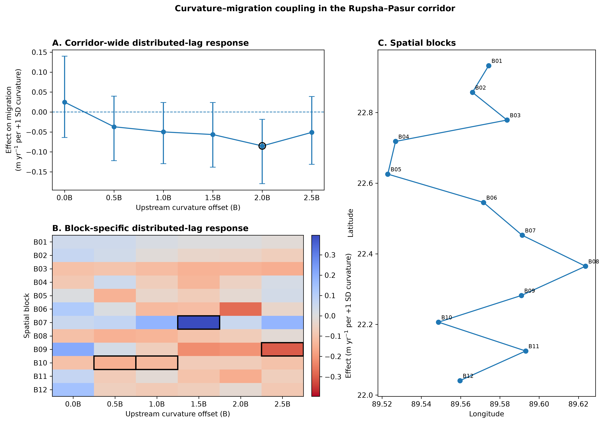
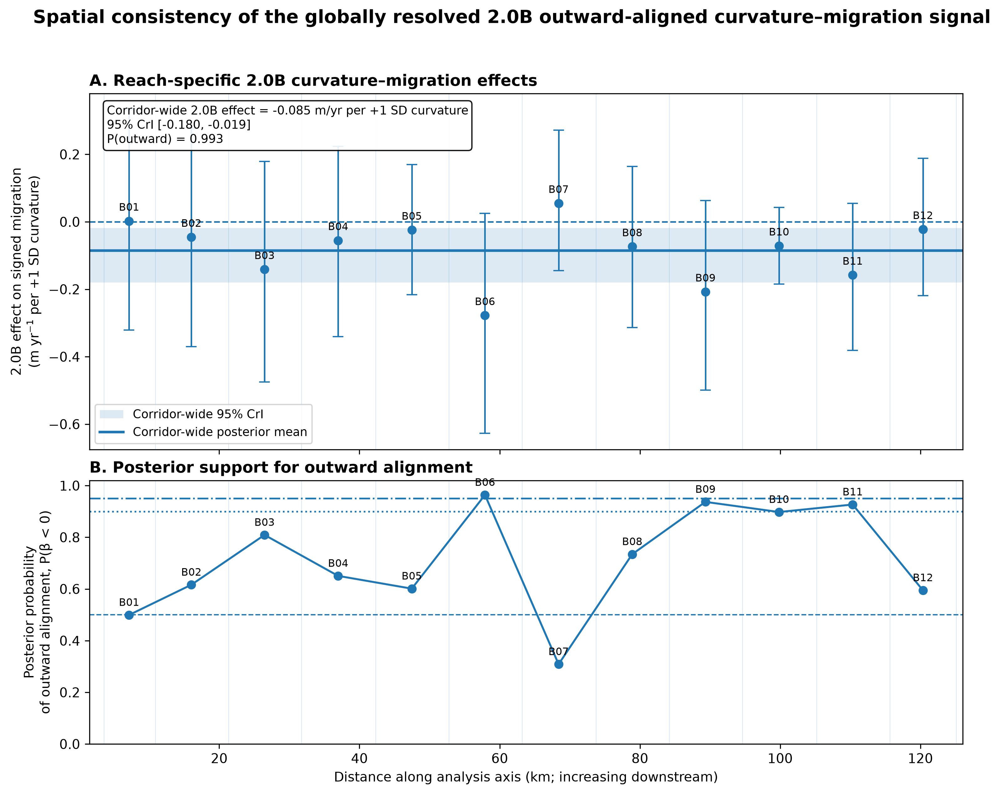

# Rupsha–Pasur Morphodynamics

## Spatially Offset Curvature–Migration Coupling in the Tidal Rupsha–Pasur River Corridor from Multi-Decadal Satellite Observations

**Research project · Manuscript in final preparation**

This repository supports a research manuscript examining how antecedent channel geometry is associated with subsequent lateral migration along the tidal Rupsha–Pasur river corridor in southwest Bangladesh.

Using multi-decadal Landsat-derived channel geometry, the study combines signed channel curvature, width-normalized upstream spatial offsets, lateral mapped-centerline migration, measurement-uncertainty assessment, and hierarchical Bayesian distributed-lag modeling.

---

## Research question

**How does antecedent channel curvature, evaluated at local and upstream spatial offsets, relate to subsequent lateral mapped-centerline migration, and how does that relationship vary along the river corridor?**

Curvature is evaluated at six prespecified upstream spatial offsets:

`0B · 0.5B · 1B · 1.5B · 2B · 2.5B`

where **B** is the start-state local channel width at the response station.

---

## Study scale

| Component | Value |
|---|---:|
| Observation span | 1988–2025 |
| Analysis years | 35 |
| Inferential common-support corridor | ~121.6 km |
| Inferential observations | 25,923 |
| Unique stations | 1,014 |
| Spatial blocks | 12 |
| Migration periods | 34 |
| Primary curvature scale | W15 signed, width-normalized curvature (κB) |

Annual states are not uninterrupted: 2007, 2011, and 2012 are absent from the analysis record.

---

## Analytical workflow

The project integrates:

- adaptive MNDWI-based Landsat water extraction;
- topology-connected reconstruction of the main channel;
- fixed-axis satellite-observed outer water–land boundary proxies and mapped centerlines;
- channel-width estimation;
- signed channel curvature;
- width-normalized upstream spatial offsets;
- continuous signed mapped-centerline migration;
- empirical measurement-uncertainty analysis;
- spatial and temporal hierarchical effects; and
- Bayesian Student-t distributed-lag inference.

The scientific offset framework is **spatial rather than temporal**. For a response location at position `s`, curvature at multiplier `λ` is evaluated upstream at:

`target position = s − λ × start-state local channel width`

The statistical implementation retains distributed-lag parameter names, but manuscript interpretation refers to these quantities as **upstream spatial offsets**.

More methodological detail is provided in [`docs/methodology.md`](docs/methodology.md).

---

## Main finding

The clearest corridor-wide association among the six tested offsets occurs at approximately **2 local channel widths upstream (2B)**.

For a +1 SD increase in signed curvature at 2B, the posterior mean effect on signed mapped-centerline migration is:

**−0.085 m yr⁻¹**

with a 95% credible interval of:

**−0.180 to −0.019 m yr⁻¹**

and:

**P(β < 0) = 0.993**

Under the downstream-referenced coordinate convention used in this study, the negative coefficient corresponds to an **outward-aligned curvature–migration relationship**.

The corridor-wide magnitude is small. At 2B, **10 of 12 spatial blocks** have negative posterior means, but **0 of 12** have local 95% credible intervals entirely below zero. The global result is therefore interpreted as a spatially widespread directional tendency with substantial local uncertainty, not as a uniform reach-scale effect.

---

## Main result figure



The public figure summarizes the corridor-wide posterior and spatially varying curvature–migration results.

---

## Spatial consistency of the 2B signal



At 2B, 10 of 12 block posterior means are negative. Three blocks have P(outward) ≥ 0.90, one has P(outward) ≥ 0.95, and none has a fully negative local 95% credible interval.

---

## Reach-scale heterogeneity

Across the complete 0–2.5B offset domain, **four block-by-offset effects** have 95% credible intervals excluding zero:

- B07 at 1.5B: inward-aligned, +0.397 m yr⁻¹ per +1 SD κB (95% CrI 0.176 to 0.638);
- B09 at 2.5B: outward-aligned, −0.301 m yr⁻¹ (95% CrI −0.601 to −0.034);
- B10 at 0.5B: outward-aligned, −0.151 m yr⁻¹ (95% CrI −0.262 to −0.046);
- B10 at 1B: outward-aligned, −0.130 m yr⁻¹ (95% CrI −0.237 to −0.025).

These local results indicate heterogeneity in both direction and spatial offset of curvature–migration coupling.

Derived posterior summaries are available in [`results/`](results/).

---

## Statistical model

The final inferential model is a hierarchical Bayesian distributed-lag model with a continuous Student-t likelihood.

It includes:

- corridor-wide coefficients at six spatial offsets;
- mean-centered block-specific offset deviations;
- channel-width effect;
- continuous along-axis spline structure;
- station-level effects;
- temporal-period effects; and
- block-period effects.

The headline posterior is fitted to **nominal geometry**. A converged 2,000-realization joint geometry ensemble separately characterizes geometry uncertainty; measurement error is not integrated directly into the primary Bayesian likelihood.

The retained posterior contains 8,000 draws. Two NUTS divergences remained (0.025%); sensitivity checks showed negligible influence on the reported scientific quantities, so the strict zero-divergence computational gate failed while the scientific robustness checks passed.

---

## Post hoc robustness audit

Additional diagnostics were conducted without refitting or resampling the production model.

Key results:

- maximum pairwise predictor Pearson correlation: **0.296**;
- maximum pairwise predictor Spearman correlation: **0.571**;
- maximum absolute posterior correlation among the six global curvature coefficients: **0.301**;
- at 2B, Pearson correlation changed from **−0.0492** for all observations to **−0.0724** among nonzero extracted displacements;
- at 2B, Spearman correlation changed from **−0.0621** to **−0.0920** among nonzero extracted displacements;
- posterior-mean residual correlation declined from **0.272 at ~0.12 km** to **0.090 at ~1.2 km**, **0.026 at ~2.4 km**, and approximately zero by **~4.8 km**;
- phase-balanced spatial thinning preserved a negative 2B descriptive association through approximately **2.4 km** station spacing, with 2B negative across every tested phase at that spacing.

A posterior predictive check identified an important likelihood limitation: the continuous Student-t model does not reproduce the large extraction-level exact-zero concentration or the full central response distribution. The observed P99 absolute response was nevertheless within the 95% posterior predictive interval. These diagnostics are treated as robustness assessments and do not alter the primary posterior estimates.

See [`docs/robustness_audit.md`](docs/robustness_audit.md) and the robustness tables in [`results/`](results/).

---

## Interpretation boundary

This study identifies **conditional associations** between antecedent channel geometry and subsequent signed mapped-centerline migration.

The results should not be interpreted as showing that curvature alone causes migration, as identifying a universal physical optimum at exactly 2B, or as evidence of demonstrated out-of-sample predictive performance.

The mapped boundaries are satellite-observed outer water–land boundary proxies, not surveyed geomorphic banks.

---

## Repository contents

```text
Rupsha-Pasur-Morphodynamics/
├── README.md
├── PROJECT_STATUS.md
├── CITATION.cff
├── environment.yml
├── LICENSE.md
├── LICENSES/
├── data/
│   ├── README.md
│   └── inferential_model_input.csv.gz
├── docs/
│   ├── methodology.md
│   ├── results_summary.md
│   ├── headline_findings.md
│   ├── robustness_audit.md
│   └── verified_project_facts.csv
├── figures/
│   ├── main_curvature_migration_results.png
│   └── twoB_spatial_consistency.png
├── notebooks/
│   └── README.md
├── results/
│   ├── global_distributed_lag_results.csv
│   ├── block_specific_lag_results.csv
│   ├── spatial_block_locations.csv
│   ├── twoB_evidence_summary.csv
│   ├── robustness_diagnostics_summary.csv
│   ├── zero_nonzero_curvature_association_sensitivity.csv
│   ├── six_offset_predictor_pearson_correlation.csv
│   ├── six_offset_predictor_spearman_correlation.csv
│   ├── six_offset_global_beta_posterior_correlation.csv
│   ├── posterior_mean_residual_spatial_dependence.csv
│   └── spatial_thinning_summary.csv
└── src/
    ├── README.md
    ├── bayesian_model.py
    └── results_figures.py
```

Large Landsat scenes, raster intermediates, Monte Carlo realizations, and full posterior files are intentionally excluded from the public repository.

---

## Data and reproducibility

Compact derived scientific outputs are provided in `results/`.

The repository includes the final Bayesian model implementation in `src/bayesian_model.py` and a lightweight figure-reproduction workflow in `src/results_figures.py`. The public result tables are sufficient to inspect the reported posterior summaries and post hoc robustness audit without re-running the multi-hour Bayesian sampler.

See [`data/README.md`](data/README.md) for the data-availability strategy.

---

## Environment

A Conda environment specification is provided in [`environment.yml`](environment.yml).

Create the environment with:

```bash
conda env create -f environment.yml
conda activate rupsha-pasur-morphodynamics
```

To regenerate the existing public result figures:

```bash
python src/results_figures.py
```

---

## Project status

**Manuscript in final preparation.**

The primary scientific analysis, posterior sensitivity audit, and post hoc robustness diagnostics are complete. Final manuscript assembly and publication-quality figure preparation are underway.

---

## Citation

Citation metadata is provided in [`CITATION.cff`](CITATION.cff).

A formal article citation will be added after preprint or publication release.

---

## License

Source code is available under the **MIT License**.

Original figures, documentation, and derived research result tables are available under **CC BY 4.0**.

See [`LICENSE.md`](LICENSE.md) for the scope of each license.